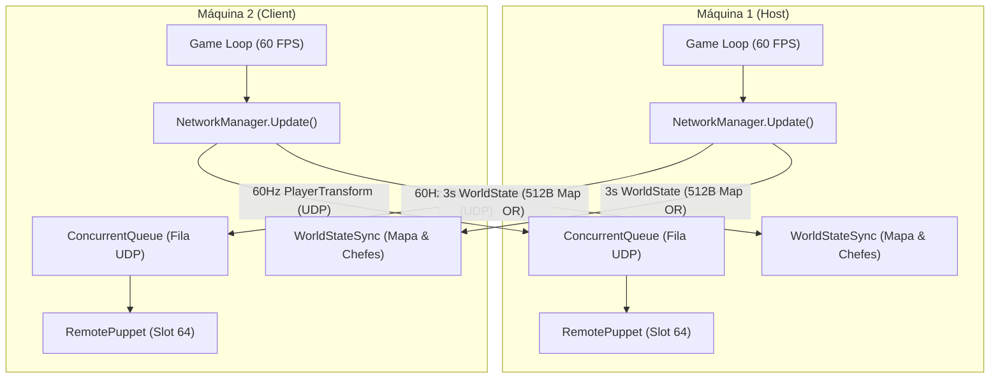

# 🌐 Manual & Documentação Completa do Multiplayer — SymphonyRecomp

Este documento reúne a documentação técnica, guia de usuário e arquitetura do subsistema de **Multiplayer Co-op & Duelos PvP** do **Castlevania: Symphony of the Night — SymphonyRecomp (State of the Art Edition)**.

---

## 📖 Sumário
1. [Visão Geral & Filosofia de Design](#-1-visão-geral--filosofia-de-design)
2. [Como Conectar & Jogar (Guia Passo a Passo)](#-2-como-conectar--jogar-guia-passo-a-passo)
   - [Acessando o Painel de Multiplayer](#acessando-o-painel-de-multiplayer)
   - [Hospedando uma Sessão (Host)](#hospedando-uma-sessão-host)
   - [Entrando em uma Sessão (Client)](#entrando-em-uma-sessão-client)
   - [Cenários de Conexão (Rede Local, IP Público e VPNs Virtuais)](#cenários-de-conexão)
3. [Recursos & Mecânicas de Jogo](#-3-recursos--mecânicas-de-jogo)
   - [Exploração Livre Desacoplada (Sem Tela Dividida)](#exploração-livre-desacoplada)
   - [Mini-Mapa Compartilhado & Live Radar Scanner](#mini-mapa-compartilhado--live-radar-scanner)
   - [Renderização do Parceiro Remoto (Remote Puppet)](#renderização-do-parceiro-remoto-remote-puppet)
   - [Buddy Warp (Teleporte Cooperativo)](#buddy-warp-teleporte-cooperativo)
   - [Duelos PvP na Arena do Coliseu](#duelos-pvp-na-arena-do-coliseu)
   - [Sincronização de Progresso de Chefes](#sincronização-de-progresso-de-chefes)
   - [Chat da Sessão & Avisos Rápidos](#chat-da-sessão--avisos-rápidos)
4. [Arquitetura Técnica & Engenharia de Rede](#-4-arquitetura-técnica--engenharia-de-rede)
   - [Protocolo Binário UDP 60Hz](#protocolo-binário-udp-60hz)
   - [Catálogo de Pacotes e OpCodes](#catálogo-de-pacotes-e-opcodes)
   - [Payload de Transformação a 60Hz](#payload-de-transformação-a-60hz)
   - [Diagrama de Arquitetura](#diagrama-de-arquitetura)
5. [Módulos & Estrutura de Arquivos](#-5-módulos--estrutura-de-arquivos)
6. [Resolução de Problemas (Troubleshooting & FAQ)](#-6-resolução-de-problemas-troubleshooting--faq)
7. [Suíte de Testes Automatizados (Validação Técnica)](#-7-suíte-de-testes-automatizados-validação-técnica)

---

## 🎯 1. Visão Geral & Filosofia de Design

Diferente de soluções convencionais de emuladores que utilizam rollback ou travamento de quadros com tela dividida forçada, o sistema de multiplayer do **SymphonyRecomp** foi construído nativamente em **C# (.NET 10)** tirando proveito da recompilação estática:

* **Desempenho Nativo a 60 FPS com Latência Zero de Entrada**: Cada jogador roda sua própria simulação nativa do jogo em tela cheia. Os comandos do seu controle respondem imediatamente sem atraso de rede.
* **Exploração Desacoplada**: Os jogadores não ficam presos à mesma tela ou câmera. Um jogador pode estar explorando as Catacumbas enquanto o outro enfrenta inimigos na Torre do Relógio.
* **Rede Peer-to-Peer (P2P UDP)**: Conexão direta entre os computadores dos jogadores, sem intermediários ou custos de servidores dedicados.
* **Sincronização Híbrida Inteligente**: 
  * *Em tempo real (60Hz)*: Posição, animações, direção, vida (HP) e ataques dos jogadores.
  * *Por eventos (Periódico / 3s)*: Descoberta de salas do mapa e flags de derrota de chefes.
  * *Simulação local*: Inimigos comuns rodam em cada cliente, garantindo física e combate responsivos sem jitter.

---

## 🚀 2. Como Conectar & Jogar (Guia Passo a Passo)

### Acessando o Painel de Multiplayer
1. Durante o jogo, pressione **`F11`** (ou mova o cursor do mouse até o topo da tela) para abrir a barra de menus gráfica do ImGui.
2. Navegue até o menu **`Diversos` → `Multiplayer Co-op & PvP`** ([`MultiplayerPanel.cs`](file:///Users/guhf/Documents/Workspace/SymphonyRecomp/patches/netplay/MultiplayerPanel.cs#L10-L68)).
3. Uma janela dedicada com 4 abas será exibida:
   * **Lobby & Conexão**
   * **🗺️ Mapa Co-op & Radar**
   * **Jogadores & Status**
   * **Chat & Avisos**

---

### Hospedando uma Sessão (Host)
1. No campo **"Seu Nome"**, digite o apelido que deseja exibir ao seu parceiro.
2. Defina o número da **Porta** (padrão: `7777`).
3. Clique no botão **"🛡️ Hospedar Sessão (Host)"**.
4. O helper de rede ([`NatHelper.cs`](file:///Users/guhf/Documents/Workspace/SymphonyRecomp/patches/netplay/NatHelper.cs#L8-L47)) detectará seu endereço IP público automaticamente.
5. Clique no botão **"📋 Copiar Meu IP para Enviar ao Amigo"** e envie esse endereço para a pessoa que jogará com você.
6. O status indicará que o jogo está aguardando a conexão do parceiro.

---

### Entrando em uma Sessão (Client)
1. Certifique-se de que o Host já iniciou a hospedagem.
2. No campo **"Seu Nome"**, digite seu apelido.
3. No campo **"IP do Servidor / Amigo"**, cole o IP informado pelo Host.
4. Ajuste a **Porta** caso o Host tenha escolhido uma porta diferente de `7777`.
5. Clique em **"⚔️ Conectar ao Amigo (Client)"**.
6. Uma notificação toast animada surgirá na tela confirmando a conexão mútua (*"⚔️ Multiplayer Conectado!"*).

---

### Cenários de Conexão

| Cenário | O que utilizar no campo IP | Como configurar |
| :--- | :--- | :--- |
| **Mesma Casa (Rede Local / Wi-Fi)** | IP Local do Host (ex: `192.168.1.15`) | Não requer configuração no roteador. Basta estarem na mesma rede Wi-Fi/cabo. |
| **Internet Direta (Port Forwarding)** | IP Público do Host (copiado pelo botão do menu) | O Host deve abrir a porta **UDP 7777** nas configurações do roteador. |
| **VPN Virtual Gratuita (Sem mexer no roteador)** | IP Virtual da VPN (ex: `100.x.y.z` ou `26.x.y.z`) | Utilize serviços como **Tailscale**, **Radmin VPN** ou **ZeroTier**. Conecte ambos na mesma rede virtual e use o IP gerado pelo aplicativo. |

---

## ⚔️ 3. Recursos & Mecânicas de Jogo

### Exploração Livre Desacoplada
Ambos os jogadores possuem total autonomia. Cada jogador mantém seu inventário, relíquias ativas, sub-armas e equipamentos de forma independente. Não há limitação de distância entre os dois participantes no castelo.

---

### Mini-Mapa Compartilhado & Live Radar Scanner
Gerenciado por [`WorldStateSync.cs`](file:///Users/guhf/Documents/Workspace/SymphonyRecomp/patches/netplay/WorldStateSync.cs#L8-L79) e exibido na aba **"🗺️ Mapa Co-op & Radar"**:
* **Buffer de 512 Bytes**: Abrange a totalidade do Castelo Normal e do Castelo Invertido (`Map.CastleMapAddr`).
* **União Binária Automática (Bitwise OR)**: Quando seu parceiro entra em uma sala secreta ou inexplorada, o bit correspondente é enviado e incorporado instantaneamente na sua memória de jogo.
* **Legenda Visual do Radar ImGui**:
  * 🟦 **Azul**: Quadrantes explorados exclusivamente por você.
  * 🟧 **Laranja**: Quadrantes explorados pelo parceiro remoto.
  * 🟩 **Verde**: Quadrantes explorados por ambos os jogadores.
  * 👑 **Marcador Branco/Ciano**: Posição exata do jogador local.
  * 🗡️ **Marcador Vermelho com Nome**: Posição e direção do parceiro em tempo real.

---

### Renderização do Parceiro Remoto (Remote Puppet)
Controlado por [`RemotePuppet.cs`](file:///Users/guhf/Documents/Workspace/SymphonyRecomp/patches/netplay/RemotePuppet.cs#L8-L100):
* **Slot de Entidade Dedicado (`Slot 64`)**: Quando ambos os jogadores entram na mesma sala e no mesmo estágio do castelo, o sistema aloca o slot 64 (`Entities.At(PuppetEntitySlot)`) da memória do jogo para projetar o personagem remoto.
* **Interpolação de Movimento Suave (`Lerp 0.35`)**: Amortece oscilações de pacotes na rede, eliminando teletransportes bruscos e garantindo movimentação fluida.
* **Skins e Paletas Alternativas**:
  * O Host utiliza a paleta padrão do personagem selecionado.
  * O Client recebe uma paleta de cores alternativa (`paletteId = 1`) para evitar confusão visual durante combates conjuntos.
* **Suporte a Múltiplos Personagens**: Reconhece automaticamente se o parceiro está jogando com Alucard ou Richter Belmont.

---

### Buddy Warp (Teleporte Cooperativo)
Implementado em [`NetworkManager.RequestBuddyWarp()`](file:///Users/guhf/Documents/Workspace/SymphonyRecomp/patches/netplay/NetworkManager.cs#L327-L331):
* Disponível com um clique no botão **"✨ Teleportar até o Amigo (Buddy Warp)"**.
* Permite que um jogador salte instantaneamente para o estágio (`StageId`) e coordenadas de sala (`RoomX`, `RoomY`) onde o parceiro está, ideal para se reunirem rapidamente antes de uma batalha de chefe.

---

### Duelos PvP na Arena do Coliseu
Gerenciado por [`PvPManager.cs`](file:///Users/guhf/Documents/Workspace/SymphonyRecomp/patches/netplay/PvPManager.cs#L7-L37):
* **Ativação Automática de Duelo**: Quando ambos os jogadores adentram a área do **Coliseu** (`Stage.Colosseum`) ou do **Coliseu Invertido** (`Stage.ReverseColosseum`) na mesma sala, o modo PvP é ativado.
* **Alerta Cinematográfico**: Notificação toast na tela anuncia: *"⚔️ ARENA DO COLISEU! Duelo PvP Ativado! 3.. 2.. 1.. LUTEM!"*.
* **Placar de Vitórias**: A aba **"Jogadores & Status"** registra as vitórias de cada jogador em tempo real.

---

### Sincronização de Progresso de Chefes
* O sistema sincroniza o buffer de 64 bytes de eventos de Time Attack (`Progress.TimeAttackAddr`).
* Se o parceiro derrota um chefe principal da campanha, o registro é compartilhado para manter a coerência da história e das portas destravadas no castelo.

---

### Chat da Sessão & Avisos Rápidos
Exibido na aba **"Chat & Avisos"** de [`MultiplayerPanel.cs`](file:///Users/guhf/Documents/Workspace/SymphonyRecomp/patches/netplay/MultiplayerPanel.cs#L262-L296):
* **Avisos Rápidos de 1 Clique**:
  * *"Preciso de ajuda!"*
  * *"Chefe encontrado!"*
  * *"Achei uma passagem secreta!"*
  * *"Teleporte até mim!"*
* **Chat de Texto Livre**: Campo para digitar qualquer mensagem.
* As mensagens surgem na tela em formato de **Toast Notifications** animadas com o nome do remetente.

---

## 🛠️ 4. Arquitetura Técnica & Engenharia de Rede

### Protocolo Binário UDP 60Hz
A camada de rede não utiliza frameworks pesados ou bibliotecas de terceiros; foi desenvolvida diretamente sobre os sockets assíncronos do .NET (`System.Net.Sockets.UdpClient`) para garantir a menor pegada de memória e taxa de transferência otimizada.

Cada pacote binário inicia com **1 byte de cabeçalho (`OpCode`)**, seguido imediatamente pela carga útil em formato Little-Endian ([`NetworkPacket.cs`](file:///Users/guhf/Documents/Workspace/SymphonyRecomp/patches/netplay/NetworkPacket.cs#L7-L50)).

---

### Catálogo de Pacotes e OpCodes

| OpCode | Hex | Descrição | Frequência |
| :--- | :---: | :--- | :--- |
| [`Ping`](file:///Users/guhf/Documents/Workspace/SymphonyRecomp/patches/netplay/NetworkPacket.cs#L9) | `0x01` | Sonda de latência enviada para medir o ping em milissegundos. | A cada 1.0s |
| [`Pong`](file:///Users/guhf/Documents/Workspace/SymphonyRecomp/patches/netplay/NetworkPacket.cs#L10) | `0x02` | Resposta imediata à sonda de ping para cálculo de RTT. | Sob demanda |
| [`Handshake`](file:///Users/guhf/Documents/Workspace/SymphonyRecomp/patches/netplay/NetworkPacket.cs#L11) | `0x03` | Solicitação inicial de conexão do Client contendo o nome do jogador. | Ao conectar |
| [`HandshakeAck`](file:///Users/guhf/Documents/Workspace/SymphonyRecomp/patches/netplay/NetworkPacket.cs#L12) | `0x04` | Confirmação de conexão enviada pelo Host ao aceitar o Client. | Ao conectar |
| [`Disconnect`](file:///Users/guhf/Documents/Workspace/SymphonyRecomp/patches/netplay/NetworkPacket.cs#L13) | `0x05` | Aviso de encerramento amigável da sessão multiplayer. | Ao sair |
| [`PlayerTransform`](file:///Users/guhf/Documents/Workspace/SymphonyRecomp/patches/netplay/NetworkPacket.cs#L14) | `0x10` | Pacote delta de estado do jogador (coordenadas, animação, vida, ação). | **60 vezes/seg (60Hz)** |
| [`WorldState`](file:///Users/guhf/Documents/Workspace/SymphonyRecomp/patches/netplay/NetworkPacket.cs#L15) | `0x20` | Sincronização do buffer de mapa explorado e chefes derrotados. | A cada 3.0s |
| [`BuddyWarp`](file:///Users/guhf/Documents/Workspace/SymphonyRecomp/patches/netplay/NetworkPacket.cs#L16) | `0x30` | Solicitação de teleporte imediato para as coordenadas do parceiro. | Manual |
| [`PvPHit`](file:///Users/guhf/Documents/Workspace/SymphonyRecomp/patches/netplay/NetworkPacket.cs#L17) | `0x40` | Registro de acerto ou evento de combate na arena do Coliseu. | Manual |
| [`ChatMessage`](file:///Users/guhf/Documents/Workspace/SymphonyRecomp/patches/netplay/NetworkPacket.cs#L18) | `0x50` | Transmissão de texto UTF-8 de avisos ou mensagens da sessão. | Manual |

---

### Payload de Transformação a 60Hz
O método [`NetworkPacket.CreatePlayerTransform()`](file:///Users/guhf/Documents/Workspace/SymphonyRecomp/patches/netplay/NetworkPacket.cs#L53-L91) serializa o estado em um pacote compacto de apenas **~36 bytes**:

```text
+----------+----------+----------+-------------------+-------------------+-------------------+-------------------+
| StageId  |  RoomX   |  RoomY   |   PosX (Int16)    |   PosY (Int16)    |   VelX (Int16)    |   VelY (Int16)    |
| (1 byte) | (1 byte) | (1 byte) |     (2 bytes)     |     (2 bytes)     |     (2 bytes)     |     (2 bytes)     |
+----------+----------+----------+-------------------+-------------------+-------------------+-------------------+
| Facing   |  AnimId  | FrameId  |   CurHp (UInt16)  |  MaxHp (UInt16)   | Character | PalId | AttackTrig | SubW |
| (1 byte) | (1 byte) | (1 byte) |     (2 bytes)     |     (2 bytes)     |  (1 byte) | (1 b) |  (1 byte)  | (1b) |
+----------+----------+----------+-------------------+-------------------+-----------+-------+------------+------+
```

---

### Diagrama de Arquitetura



---

## 📂 5. Módulos & Estrutura de Arquivos

Todos os arquivos que compõem o subsistema de netplay estão concentrados no diretório [`patches/netplay/`](file:///Users/guhf/Documents/Workspace/SymphonyRecomp/patches/netplay/):

| Arquivo | Classe Principal | Responsabilidade |
| :--- | :--- | :--- |
| [`NetworkManager.cs`](file:///Users/guhf/Documents/Workspace/SymphonyRecomp/patches/netplay/NetworkManager.cs) | [`NetworkManager`](file:///Users/guhf/Documents/Workspace/SymphonyRecomp/patches/netplay/NetworkManager.cs#L29) | Gerenciador global de conexão UDP, fila assíncrona, cálculo de ping e broadcast de transformações a 60Hz. |
| [`NetworkPacket.cs`](file:///Users/guhf/Documents/Workspace/SymphonyRecomp/patches/netplay/NetworkPacket.cs) | [`NetworkPacket`](file:///Users/guhf/Documents/Workspace/SymphonyRecomp/patches/netplay/NetworkPacket.cs#L21) | Serialização e desserialização binária dos pacotes e estruturas delta de jogador e mundo. |
| [`MultiplayerPanel.cs`](file:///Users/guhf/Documents/Workspace/SymphonyRecomp/patches/netplay/MultiplayerPanel.cs) | [`MultiplayerPanel`](file:///Users/guhf/Documents/Workspace/SymphonyRecomp/patches/netplay/MultiplayerPanel.cs#L10) | Interface gráfica em ImGui: Lobby de conexão, Radar 2D de salas, monitor de jogadores e painel de chat. |
| [`RemotePuppet.cs`](file:///Users/guhf/Documents/Workspace/SymphonyRecomp/patches/netplay/RemotePuppet.cs) | [`RemotePuppet`](file:///Users/guhf/Documents/Workspace/SymphonyRecomp/patches/netplay/RemotePuppet.cs#L8) | Controle da entidade fantoche (`Slot 64`) do parceiro na mesma sala com interpolação linear (`Lerp 0.35`). |
| [`WorldStateSync.cs`](file:///Users/guhf/Documents/Workspace/SymphonyRecomp/patches/netplay/WorldStateSync.cs) | [`WorldStateSync`](file:///Users/guhf/Documents/Workspace/SymphonyRecomp/patches/netplay/WorldStateSync.cs#L8) | Sincronizador de buffer de salas exploradas (512 bytes) e eventos de chefes (`TimeAttackAddr`). |
| [`PvPManager.cs`](file:///Users/guhf/Documents/Workspace/SymphonyRecomp/patches/netplay/PvPManager.cs) | [`PvPManager`](file:///Users/guhf/Documents/Workspace/SymphonyRecomp/patches/netplay/PvPManager.cs#L7) | Detecção de entrada na arena do Coliseu, ativação de combate x1 e placar de pontuação. |
| [`NatHelper.cs`](file:///Users/guhf/Documents/Workspace/SymphonyRecomp/patches/netplay/NatHelper.cs) | [`NatHelper`](file:///Users/guhf/Documents/Workspace/SymphonyRecomp/patches/netplay/NatHelper.cs#L8) | Identificação assíncrona do endereço IP público e rotinas de suporte a travessia de NAT/UPnP. |
| [`QualityOfLife.cs`](file:///Users/guhf/Documents/Workspace/SymphonyRecomp/patches/qol/QualityOfLife.cs) | [`QualityOfLife`](file:///Users/guhf/Documents/Workspace/SymphonyRecomp/patches/qol/QualityOfLife.cs#L77-L89) | Ponto de integração do ciclo de atualização do multiplayer e PvP dentro do loop principal de gameplay. |

---

## ❓ 6. Resolução de Problemas (Troubleshooting & FAQ)

### 1. O Client clica em "Conectar", mas a sessão permanece em "Connecting" ou desconecta
* **Causa**: Os pacotes UDP estão sendo bloqueados pelo Firewall do computador do Host ou pelo roteador.
* **Solução**:
  1. No computador do Host, verifique se o executável do SymphonyRecomp tem permissão de comunicação no Firewall do sistema operacional (Windows Defender / macOS Security).
  2. Caso joguem via internet pública, certifique-se de que a porta **UDP 7777** está aberta (Port Forward) no roteador apontando para o IP local da máquina do Host.
  3. Alternativa recomendada: Usem uma rede virtual privada como **Tailscale** ou **Radmin VPN** — elas realizam a conexão direta dispensando qualquer configuração no roteador.

### 2. O meu parceiro não aparece na mesma sala que eu
* **Causa**: O parceiro pode estar em um estágio diferente do castelo (por exemplo, um no Castelo Normal e outro no Castelo Invertido) ou em uma sala com coordenadas distintas.
* **Solução**:
  1. Abra o painel de Multiplayer (`F11` → `Diversos` → `Multiplayer Co-op & PvP`).
  2. Vá na aba **"Jogadores & Status"** ou **"🗺️ Mapa Co-op & Radar"**.
  3. Clique em **"✨ Teleportar até o Amigo (Buddy Warp)"** para ser colocado exatamente na mesma coordenada do seu parceiro.

### 3. As portas abertas e alavancas continuam no mesmo estado para o parceiro?
* As salas do mapa explorado e os chefes derrotados são sincronizados continuamente via [`WorldStateSync.cs`](file:///Users/guhf/Documents/Workspace/SymphonyRecomp/patches/netplay/WorldStateSync.cs). Portas acionadas por chefes ou itens-chave são compartilhadas assim que os eventos de progresso são validados na memória do jogo.

### 4. Como jogar com Richter Belmont e Alucard juntos?
* O sistema identifica a seleção de personagem do savegame de cada jogador (`character = Player.IsRichter ? 1 : 0`). É possível jogar **Alucard + Richter**, **Alucard + Alucard** ou **Richter + Richter** sem qualquer conflito. No caso de personagens iguais, a paleta alternativa do Client evita que fiquem com a mesma aparência.

---

## 🧪 7. Suíte de Testes Automatizados (Validação Técnica)

Para validar a integridade de todas as camadas de rede, serialização binária, convergência de interpolação e comunicação socket real P2P, o projeto conta com uma suíte de testes dedicada em [`tests/MultiplayerTests/`](file:///Users/guhf/Documents/Workspace/SymphonyRecomp/tests/MultiplayerTests/Program.cs).

### Como Executar os Testes
No terminal, a partir da raiz do repositório, execute:
```bash
~/.dotnet/dotnet run --project tests/MultiplayerTests/MultiplayerTests.csproj
```
*(ou `dotnet run --project tests/MultiplayerTests/MultiplayerTests.csproj` se o .NET 10 SDK estiver configurado no PATH).*

### O que é Testado (75 Asserções / 100% Sucesso)
1. **Serialização e Deserialização de Pacotes ([`NetworkPacket.cs`](file:///Users/guhf/Documents/Workspace/SymphonyRecomp/patches/netplay/NetworkPacket.cs))**:
   - `Handshake` e `HandshakeAck` com nomes de jogadores em UTF-8.
   - `PlayerTransform`: Integridade exata dos 16 campos em 36 bytes (coordenadas, vetores de velocidade, direção, flags de ataque, sub-armas, HP).
   - Casos de borda: coordenadas negativas extremas (`short.MinValue`), HP máximo (`65535`), velocidades limites.
   - `WorldState`: Integridade byte-a-byte do buffer de mapa (512 bytes) e eventos de chefes (64 bytes).
   - `ChatMessage`: Suporte a caracteres especiais, acentuação em português e emojis sem corrupção.
   - `Ping` e `Pong`: Carga útil vazia.
   - **Resiliência a Fuzzing**: Rejeição graciosa de pacotes truncados, nulos ou corrompidos sem interrupção de execução.
2. **Lógica de Sincronização de Mundo ([`WorldStateSync.cs`](file:///Users/guhf/Documents/Workspace/SymphonyRecomp/patches/netplay/WorldStateSync.cs))**:
   - Algoritmo de união binária (*bitwise OR*) do mapa: descoberta de salas sem sobrescrita indevida.
   - Sincronização de derrotas de chefes: persistência dos chefes já derrotados e avanço conjunto.
3. **Interpolação de Movimento & Fantoche ([`RemotePuppet.cs`](file:///Users/guhf/Documents/Workspace/SymphonyRecomp/patches/netplay/RemotePuppet.cs))**:
   - Matemática de suavização de movimento (*Lerp 0.35*) frame-a-frame convergindo suavemente para as coordenadas reais do parceiro.
   - Distinção de paletas para Host (`paletteId = 0`) e Client (`paletteId = 1`).
4. **Regras de Arena PvP ([`PvPManager.cs`](file:///Users/guhf/Documents/Workspace/SymphonyRecomp/patches/netplay/PvPManager.cs))**:
   - Validação de regras de acionamento do combate no Coliseu e no Coliseu Invertido.
   - Isolamento de combate quando os jogadores estão em salas separadas.
   - Contabilização e atualização de placar de vitórias.
5. **Integração Real UDP Socket Loopback**:
   - Troca real assíncrona de pacotes UDP entre instâncias Host e Client em `127.0.0.1`.
   - Medição de tempo de ida e volta (RTT de Latência do Ping).
   - **Stream de Alta Frequência a 60Hz**: Envio de 120 pacotes contínuos de transformação com 100% de taxa de entrega e 0 perdas.

