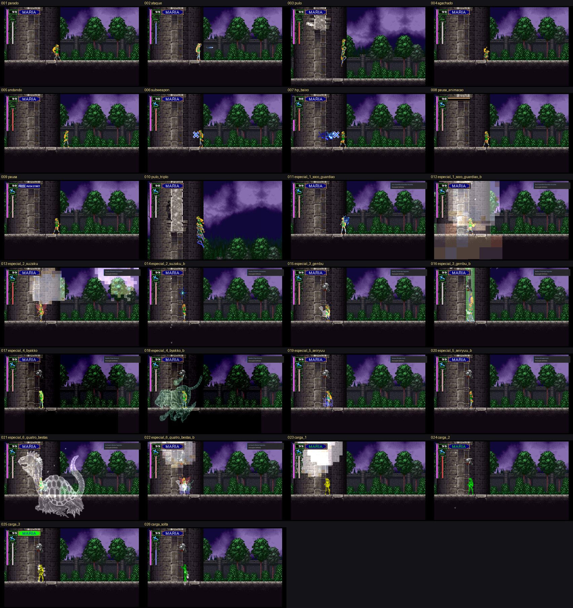
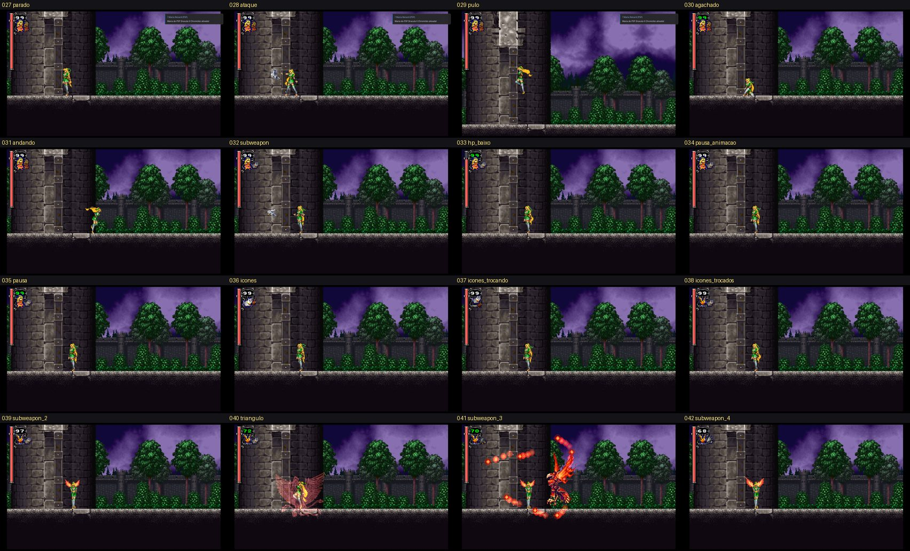
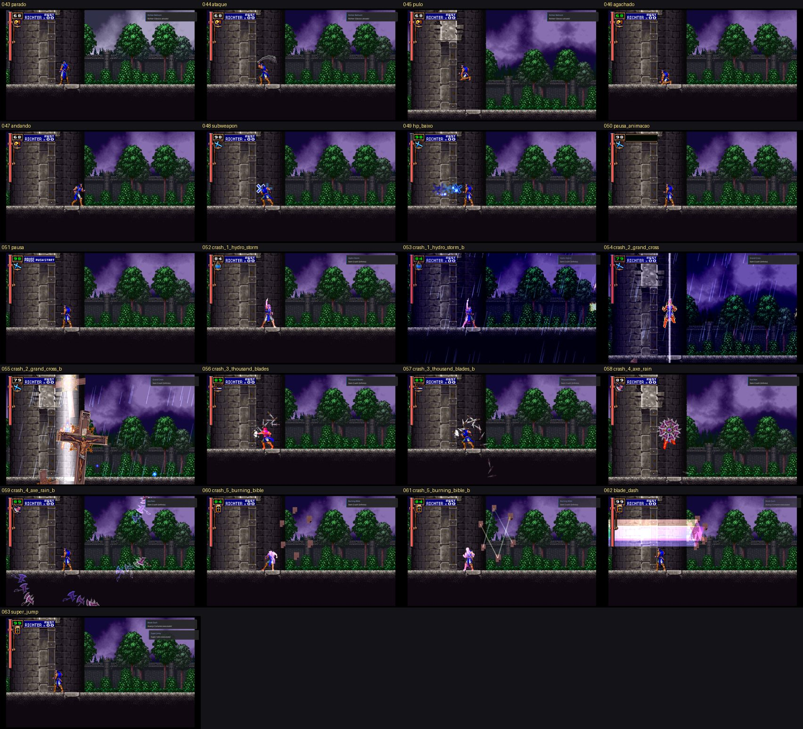
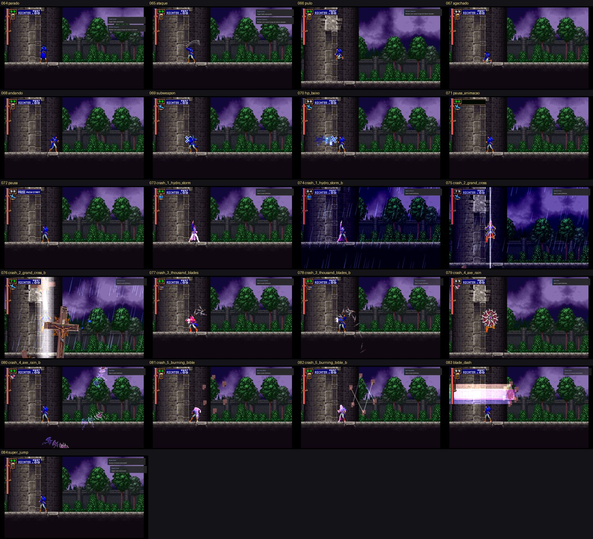
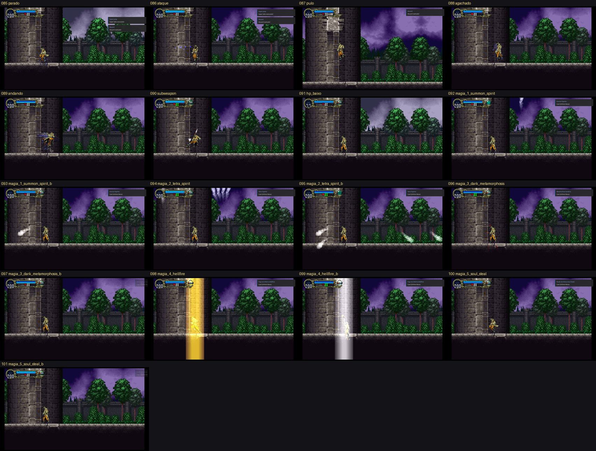
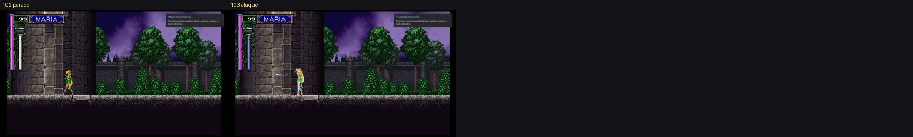

# Teste completo dos personagens (SOTN Ultimate no SymphonyRecomp)

Resultado do roteiro automático `patches/ultimate/CharacterTest.cs`, rodado em 14/11/2026 no macOS (Apple M1), disco retail USA, widescreen 16:9.

```bash
SOTN_TEST_MARIA=1 SOTN_TEST_DIR=/tmp/sotn-shots ./mac_run.sh
```

## Resumo

* **103 capturas, nenhum crash.** O jogo fecha sozinho no fim.
* **Todos os cinco personagens respondem** a ataque, pulo, agachar, andar e subweapon, e ficam no mesmo ponto depois de cada troca.
* **Saturn Maria:** os 6 especiais entram no passo próprio (`0x30`–`0x35`) com efeito na tela; pulo triplo; HUD próprio com a barra de HP descendo, a placa na pausa e o brilho da carga em 3 estágios.
* **PSP Maria:** os dois ícones no HUD e a troca com Círculo; gato, cardeal, tartaruga e dragão; Triângulo.
* **Richter e Richter de casaco:** os 5 Item Crashes com os corações descontados uma vez só (15, 20, 10, 10, 15).
* **Alucard:** as 5 magias; volta com as cores certas.
* **Som:** o SPU tocou amostras do banco de voz em todos os personagens e do banco de especiais só durante os especiais da Maria.

## Como ler a tabela

* `step`: passo do jogador / sub-passo. `0x00` parado, `0x01` andando, `0x02` agachado, `0x04` no ar. Maria (Saturn): `0x30`–`0x35` são os especiais. Richter: `0x12`–`0x1B` são os crashes. Alucard: `0x20`–`0x23` são as magias. PSP Maria: `0x1C` subweapon, `0x13` Triângulo.
* **Voz (vab1) / Especiais (vab2):** se, desde a captura anterior, alguma voz do SPU estava tocando amostras daquele banco. Mostra que o som saiu; **não** mostra se é a voz certa — isso só ouvindo.
* As capturas `_b` são 70 quadros depois do disparo do especial.

## O que este teste não cobre

* Ouvir o áudio.
* Comparar com o mod SOTN Ultimate original rodando (ícones da PSP Maria, posição exata do HUD).
* Dano real de inimigos (a barra de HP é testada gravando o HP), morte, salas de save, outras fases, chefes.
* Transformações do Alucard (morcego, névoa, lobo), que dependem de relíquias.
* Os golpes "Blade Dash" e "Super Jump" do quick-cast do Richter são atalhos do recomp (gravam velocidade), não os golpes do jogo.

## Pontos a olhar

* **Blocos translúcidos grandes** em algumas capturas dos especiais da Maria (012, 013, 022, 023): pode ser o clarão do efeito em baixa resolução ou uma textura que o mod espera e o disco retail não tem. Não foi comparado com o mod.
* O Seiryuu leva cerca de 750 quadros (12 s) até ela voltar a ficar parada.

## Resultados por personagem


### Maria (Saturn)



| # | Passo | `step` | HP | MP | Corações | Sub | Carga | Voz (vab1) | Especiais (vab2) |
| :-: | :--- | :-: | :-: | :-: | :-: | :-: | :-: | :-: | :-: |
| 001 | parado | `0x00/0` | 200/200 | 200/200 | 99 | 0 | 0 | sim | nao |
| 002 | ataque | `0x00/64` | 200/200 | 196/200 | 99 | 0 | 10 | sim | nao |
| 003 | pulo | `0x04/0` | 200/200 | 200/200 | 99 | 0 | 0 | sim | nao |
| 004 | agachado | `0x02/1` | 200/200 | 200/200 | 99 | 0 | 0 | sim | nao |
| 005 | andando | `0x01/0` | 200/200 | 200/200 | 99 | 0 | 0 | sim | nao |
| 006 | subweapon | `0x00/66` | 200/200 | 200/200 | 98 | 4 | 14 | sim | nao |
| 007 | hp_baixo | `0x00/0` | 66/200 | 200/200 | 98 | 4 | 0 | sim | nao |
| 008 | pausa_animacao | `0x00/0` | 200/200 | 200/200 | 98 | 4 | 0 | sim | nao |
| 009 | pausa | `0x00/0` | 200/200 | 200/200 | 98 | 4 | 0 | sim | nao |
| 010 | pulo_triplo | `0x04/0` | 200/200 | 200/200 | 98 | 4 | 0 | sim | nao |
| 011 | especial_1_soco_guardiao | `0x30/0` | 200/200 | 200/200 | 99 | 4 | 0 | sim | sim |
| 012 | especial_1_soco_guardiao_b | `0x00/0` | 200/200 | 200/200 | 99 | 4 | 0 | sim | sim |
| 013 | especial_2_suzaku | `0x34/0` | 200/200 | 200/200 | 99 | 4 | 0 | sim | sim |
| 014 | especial_2_suzaku_b | `0x34/0` | 200/200 | 200/200 | 99 | 4 | 0 | sim | sim |
| 015 | especial_3_genbu | `0x31/0` | 200/200 | 200/200 | 99 | 4 | 0 | sim | sim |
| 016 | especial_3_genbu_b | `0x31/0` | 200/200 | 200/200 | 99 | 4 | 0 | sim | sim |
| 017 | especial_4_byakko | `0x32/0` | 200/200 | 200/200 | 99 | 4 | 0 | sim | sim |
| 018 | especial_4_byakko_b | `0x32/0` | 200/200 | 200/200 | 99 | 4 | 0 | sim | sim |
| 019 | especial_5_seiryuu | `0x33/0` | 200/200 | 200/200 | 99 | 4 | 0 | sim | sim |
| 020 | especial_5_seiryuu_b | `0x33/0` | 200/200 | 200/200 | 99 | 4 | 0 | sim | sim |
| 021 | especial_6_quatro_bestas | `0x35/0` | 200/200 | 200/200 | 99 | 4 | 0 | sim | sim |
| 022 | especial_6_quatro_bestas_b | `0x35/0` | 200/200 | 200/200 | 99 | 4 | 0 | sim | sim |
| 023 | carga_1 | `0x00/0` | 200/200 | 200/200 | 99 | 4 | 130 | sim | nao |
| 024 | carga_2 | `0x00/0` | 200/200 | 200/200 | 99 | 4 | 245 | sim | nao |
| 025 | carga_3 | `0x00/0` | 200/200 | 200/200 | 99 | 4 | 360 | sim | nao |
| 026 | carga_solta | `0x00/0` | 200/200 | 142/200 | 99 | 4 | 0 | sim | nao |

### Maria (PSP)



| # | Passo | `step` | HP | MP | Corações | Sub | Carga | Voz (vab1) | Especiais (vab2) |
| :-: | :--- | :-: | :-: | :-: | :-: | :-: | :-: | :-: | :-: |
| 027 | parado | `0x00/0` | 200/200 | 148/200 | 99 | 5 | 0 | sim | nao |
| 028 | ataque | `0x00/0` | 200/200 | 148/200 | 99 | 5 | 0 | sim | nao |
| 029 | pulo | `0x04/0` | 200/200 | 148/200 | 99 | 5 | 0 | sim | nao |
| 030 | agachado | `0x02/1` | 200/200 | 148/200 | 99 | 5 | 0 | sim | nao |
| 031 | andando | `0x01/0` | 200/200 | 148/200 | 99 | 5 | 0 | sim | nao |
| 032 | subweapon | `0x00/1` | 200/200 | 148/200 | 99 | 1 | 0 | sim | nao |
| 033 | hp_baixo | `0x00/0` | 66/200 | 148/200 | 99 | 1 | 0 | sim | nao |
| 034 | pausa_animacao | `0x00/0` | 200/200 | 148/200 | 99 | 1 | 0 | nao | nao |
| 035 | pausa | `0x00/0` | 200/200 | 148/200 | 99 | 1 | 0 | nao | nao |
| 036 | icones | `0x00/0` | 200/200 | 148/200 | 99 | 2 | 0 | nao | nao |
| 037 | icones_trocando | `0x00/0` | 200/200 | 148/200 | 99 | 1 | 0 | nao | nao |
| 038 | icones_trocados | `0x00/0` | 200/200 | 148/200 | 99 | 1 | 0 | nao | nao |
| 039 | subweapon_2 | `0x1C/66` | 200/200 | 148/200 | 97 | 1 | 0 | sim | nao |
| 040 | triangulo | `0x13/0` | 200/200 | 148/200 | 72 | 1 | 0 | sim | nao |
| 041 | subweapon_3 | `0x1C/66` | 200/200 | 148/200 | 70 | 3 | 0 | sim | nao |
| 042 | subweapon_4 | `0x1C/66` | 200/200 | 148/200 | 68 | 8 | 0 | sim | nao |

### Richter (clássico)



| # | Passo | `step` | HP | MP | Corações | Sub | Carga | Voz (vab1) | Especiais (vab2) |
| :-: | :--- | :-: | :-: | :-: | :-: | :-: | :-: | :-: | :-: |
| 043 | parado | `0x00/0` | 200/200 | 148/200 | 68 | 8 | 0 | sim | nao |
| 044 | ataque | `0x00/64` | 200/200 | 148/200 | 68 | 8 | 0 | sim | nao |
| 045 | pulo | `0x04/0` | 200/200 | 148/200 | 68 | 8 | 0 | sim | nao |
| 046 | agachado | `0x02/0` | 200/200 | 148/200 | 68 | 8 | 0 | nao | nao |
| 047 | andando | `0x01/0` | 200/200 | 148/200 | 68 | 8 | 0 | nao | nao |
| 048 | subweapon | `0x00/66` | 200/200 | 148/200 | 98 | 4 | 0 | sim | nao |
| 049 | hp_baixo | `0x00/0` | 66/200 | 148/200 | 98 | 4 | 0 | sim | nao |
| 050 | pausa_animacao | `0x00/0` | 200/200 | 148/200 | 98 | 4 | 0 | nao | nao |
| 051 | pausa | `0x00/0` | 200/200 | 148/200 | 98 | 4 | 0 | nao | nao |
| 052 | crash_1_hydro_storm | `0x14/0` | 200/200 | 200/200 | 84 | 3 | 0 | sim | nao |
| 053 | crash_1_hydro_storm_b | `0x14/0` | 200/200 | 200/200 | 84 | 3 | 0 | sim | nao |
| 054 | crash_2_grand_cross | `0x12/1` | 200/200 | 200/200 | 79 | 4 | 0 | sim | nao |
| 055 | crash_2_grand_cross_b | `0x12/1` | 200/200 | 200/200 | 79 | 4 | 0 | sim | nao |
| 056 | crash_3_thousand_blades | `0x15/1` | 200/200 | 200/200 | 89 | 1 | 0 | sim | nao |
| 057 | crash_3_thousand_blades_b | `0x15/1` | 200/200 | 200/200 | 89 | 1 | 0 | sim | nao |
| 058 | crash_4_axe_rain | `0x12/1` | 200/200 | 200/200 | 89 | 2 | 0 | sim | nao |
| 059 | crash_4_axe_rain_b | `0x00/0` | 200/200 | 200/200 | 89 | 2 | 0 | sim | nao |
| 060 | crash_5_burning_bible | `0x1B/0` | 200/200 | 200/200 | 84 | 5 | 0 | sim | nao |
| 061 | crash_5_burning_bible_b | `0x1B/0` | 200/200 | 200/200 | 84 | 5 | 0 | nao | nao |
| 062 | blade_dash | `0x00/0` | 200/200 | 200/200 | 99 | 5 | 0 | sim | nao |
| 063 | super_jump | `0x04/0` | 200/200 | 200/200 | 99 | 5 | 0 | sim | nao |

### Richter (casaco do Saturn)



| # | Passo | `step` | HP | MP | Corações | Sub | Carga | Voz (vab1) | Especiais (vab2) |
| :-: | :--- | :-: | :-: | :-: | :-: | :-: | :-: | :-: | :-: |
| 064 | parado | `0x00/0` | 200/200 | 200/200 | 99 | 5 | 0 | sim | nao |
| 065 | ataque | `0x00/64` | 200/200 | 200/200 | 99 | 5 | 0 | sim | nao |
| 066 | pulo | `0x04/0` | 200/200 | 200/200 | 99 | 5 | 0 | sim | nao |
| 067 | agachado | `0x02/0` | 200/200 | 200/200 | 99 | 5 | 0 | nao | nao |
| 068 | andando | `0x01/0` | 200/200 | 200/200 | 99 | 5 | 0 | nao | nao |
| 069 | subweapon | `0x00/66` | 200/200 | 200/200 | 98 | 4 | 0 | sim | nao |
| 070 | hp_baixo | `0x00/0` | 66/200 | 200/200 | 98 | 4 | 0 | sim | nao |
| 071 | pausa_animacao | `0x00/0` | 200/200 | 200/200 | 98 | 4 | 0 | nao | nao |
| 072 | pausa | `0x00/0` | 200/200 | 200/200 | 98 | 4 | 0 | nao | nao |
| 073 | crash_1_hydro_storm | `0x14/0` | 200/200 | 200/200 | 84 | 3 | 0 | sim | nao |
| 074 | crash_1_hydro_storm_b | `0x14/0` | 200/200 | 200/200 | 84 | 3 | 0 | sim | nao |
| 075 | crash_2_grand_cross | `0x12/1` | 200/200 | 200/200 | 79 | 4 | 0 | sim | nao |
| 076 | crash_2_grand_cross_b | `0x12/1` | 200/200 | 200/200 | 79 | 4 | 0 | sim | nao |
| 077 | crash_3_thousand_blades | `0x15/1` | 200/200 | 200/200 | 89 | 1 | 0 | sim | nao |
| 078 | crash_3_thousand_blades_b | `0x15/1` | 200/200 | 200/200 | 89 | 1 | 0 | sim | nao |
| 079 | crash_4_axe_rain | `0x12/1` | 200/200 | 200/200 | 89 | 2 | 0 | sim | nao |
| 080 | crash_4_axe_rain_b | `0x00/0` | 200/200 | 200/200 | 89 | 2 | 0 | sim | nao |
| 081 | crash_5_burning_bible | `0x1B/0` | 200/200 | 200/200 | 84 | 5 | 0 | sim | nao |
| 082 | crash_5_burning_bible_b | `0x1B/0` | 200/200 | 200/200 | 84 | 5 | 0 | nao | nao |
| 083 | blade_dash | `0x00/0` | 200/200 | 200/200 | 99 | 5 | 0 | sim | nao |
| 084 | super_jump | `0x04/0` | 200/200 | 200/200 | 99 | 5 | 0 | sim | nao |

### Alucard



| # | Passo | `step` | HP | MP | Corações | Sub | Carga | Voz (vab1) | Especiais (vab2) |
| :-: | :--- | :-: | :-: | :-: | :-: | :-: | :-: | :-: | :-: |
| 085 | parado | `0x00/0` | 200/200 | 200/200 | 99 | 0 | 0 | sim | nao |
| 086 | ataque | `0x00/65` | 200/200 | 200/200 | 99 | 0 | 0 | nao | nao |
| 087 | pulo | `0x04/0` | 200/200 | 200/200 | 99 | 0 | 0 | nao | nao |
| 088 | agachado | `0x02/1` | 200/200 | 200/200 | 99 | 0 | 0 | nao | nao |
| 089 | andando | `0x01/0` | 200/200 | 200/200 | 99 | 0 | 0 | nao | nao |
| 090 | subweapon | `0x00/1` | 200/200 | 200/200 | 98 | 1 | 0 | sim | nao |
| 091 | hp_baixo | `0x00/0` | 66/200 | 200/200 | 98 | 1 | 0 | sim | nao |
| 092 | magia_1_summon_spirit | `0x21/0` | 200/200 | 200/200 | 99 | 1 | 0 | sim | nao |
| 093 | magia_1_summon_spirit_b | `0x00/0` | 200/200 | 200/200 | 99 | 1 | 0 | nao | nao |
| 094 | magia_2_tetra_spirit | `0x23/0` | 200/200 | 200/200 | 99 | 1 | 0 | sim | nao |
| 095 | magia_2_tetra_spirit_b | `0x00/0` | 200/200 | 200/200 | 99 | 1 | 0 | nao | nao |
| 096 | magia_3_dark_metamorphosis | `0x20/0` | 200/200 | 200/200 | 99 | 1 | 0 | sim | nao |
| 097 | magia_3_dark_metamorphosis_b | `0x00/0` | 200/200 | 200/200 | 99 | 1 | 0 | nao | nao |
| 098 | magia_4_hellfire | `0x22/1` | 200/200 | 200/200 | 99 | 1 | 0 | nao | nao |
| 099 | magia_4_hellfire_b | `0x22/3` | 200/200 | 200/200 | 99 | 1 | 0 | nao | nao |
| 100 | magia_5_soul_steal | `0x00/0` | 200/200 | 200/200 | 99 | 1 | 0 | sim | nao |
| 101 | magia_5_soul_steal_b | `0x00/0` | 200/200 | 200/200 | 99 | 1 | 0 | nao | nao |

### Maria (Saturn), de volta



| # | Passo | `step` | HP | MP | Corações | Sub | Carga | Voz (vab1) | Especiais (vab2) |
| :-: | :--- | :-: | :-: | :-: | :-: | :-: | :-: | :-: | :-: |
| 102 | parado | `0x00/0` | 200/200 | 200/200 | 99 | 1 | 0 | nao | nao |
| 103 | ataque | `0x00/64` | 200/200 | 196/200 | 99 | 1 | 10 | sim | nao |

### Esperas longas e avisos do roteiro

* `(maria_saturn: esperou 243 quadros o movimento anterior terminar)`
* `(maria_saturn: esperou 749 quadros o movimento anterior terminar)`
* `(richter: esperou 122 quadros o movimento anterior terminar)`
* `(richter: esperou 370 quadros o movimento anterior terminar)`
* `(richter_casaco: esperou 125 quadros o movimento anterior terminar)`
* `(richter_casaco: esperou 370 quadros o movimento anterior terminar)`
* `(alucard: esperou 166 quadros o movimento anterior terminar)`
